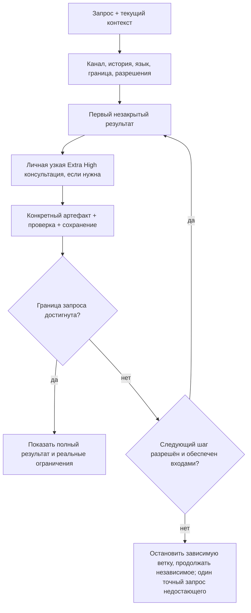

# Paper Detour: разбор сессий и рефакторинг процесса

Срез разговоров: 1 ноября 2026, Europe/Belgrade. Разобраны 21 связанная пользовательская сессия за день и две дополнительные исторические цепочки опубликованных 001/002. Цель — один входной запрос, после которого координатор сохраняет контекст, делает нужные внутренние шаги и выдаёт запрошенный результат без повторного объяснения процесса пользователем.

Главная проблема — не отсутствие инструкций про бумажный стиль. Между темой и полным сценарием не было канонической процедуры, принятые версии не всегда сохранялись, а переходы между этапами держались на ручных командах пользователя. В media-производстве к этому добавлялись поздняя проверка титров и смешение preview, принятия и фактического внешнего состояния.

Единый вход — [ytv-paper-production](../../../.agents/skills/ytv-paper-production/SKILL.md). После прямого уточнения пользователя «сюжет» означает **весь ролик**: основной маршрут идёт от идеи до проверенного локального MP4, нужного SRT, сохранённого монтажа и подготовленной упаковки. Явно текстовая задача сохраняет свою границу. Полный флоу и пример стартового промпта — в [runbook](../../../.agents/skills/ytv-paper-production/references/production-runbook.md). По следующему предложению пользователя выделены отдельные captions/thumbnails/video-titles/descriptions, переиспользованы images и release/upload; создан файловый helper титров. Актуальная проверка этого продолжения — [full-cycle refactor](full-cycle-refactor/VALIDATION.md); первоначальный сценарный default в исторических тестах ниже заменён уточнением пользователя.

## Что именно изучено

[Инвентарь](inventory.json) содержит 29 root-сессий ytvideos с видимыми сообщениями в интервале 2026-10-31 23:00Z — 2026-11-01 23:00Z: 23 сессии Paper Detour и шесть исключённых или смежных. Подробный содержательный аудит ниже охватывает 21 сессию; две сессии выпуска 030 присутствуют в инвентаре, но их полный текст в этот анализ не включён. Подагентские rollouts в корпус не входят.

Из 21 сессии извлечены 2699 видимых сообщений, в том числе 314 пользовательских и 237 финальных ответов ассистента. Из 314 пользовательских 270 относятся непосредственно к этому календарному дню; прочитана также необходимая предшествующая история. Дополнительные 001/002 дают ещё 105 пользовательских сообщений. Итого разобраны 419 пользовательских сообщений в 23 root-сессиях. Все пользовательские сообщения назначенных цепочек прочитаны; ответы изучены вокруг решений, переделок, принятия и передачи артефактов. Это не утверждение о чтении каждого tool event или скрытых рассуждений.

Проверяемые источники:

| Область | Источник | Объём |
|---|---|---|
| Сценарии, понятность, принятие, мотивационные истории | [editorial.json](evidence/editorial.json) | 7 сессий,97 user messages,38 evidence records,3 позитивных примера |
| Визуалы, титры, полный flow, упаковка и разрешения | [production-visual.json](evidence/production-visual.json) | 6 сессий,82 user messages,34 records |
| Законченные/загруженные 001/002/004/027 | [published-cases.json](evidence/published-cases.json) | 4 сессии,204 user messages,59 records; две сессии входят в сегодняшний корпус |
| 031,010, исследования тем/retention, reference и promotion | [coordinator.json](evidence/coordinator.json) | Оставшиеся 6 сегодняшних сессий,8 основных records |

Итого 139 основных записей доказательств; связанный контекст и положительные примеры хранятся дополнительно. В JSON сохранены session ID, точные цитаты, номера строк исходного rollout, версии и ограничения. [Транскрипты](transcripts/) — локальные выборки видимых сообщений. Первое извлечение было исправлено: теперь учитывает `phase=final_answer`, а не только `final`.

Thread tools использованы первыми. Ограничение списка и ошибка чтения одного слишком большого turn потребовали fallback к локальным rollouts. Архивирование не подтверждено: `task_complete` означает завершение хода, а «сессия закрыта» — слова пользователя о выполненной работе. Не смешивать это с фактическим archived status.

## Что пользователь действительно одобрил

| Цепочка | Положительный сигнал | Точный смысл и последующие ограничения |
|---|---|---|
| 001 Radio | «Отлично, очень хорошо всё получилось» после composition_fix | Принята исправленная композиция и рябь для повторного использования. После этого ещё исправлялись перекрытия, типографика и звук. Это не доказательство полного AV QA. |
| 002 Margorie | Принят живой русский пересказ и позднее «очень хорошо» о визуальной основе | Затем пользователь нашёл кольцо на трёх пальцах, неверную последовательность стуков и шрифт эпитафии. Русский пересказ не назначал RU языком готового EN видео. |
| 004 Last Video | «38.08 — идеальная сцена»; затем «ахуенно… проще и быстрее» | Первый сигнал — точный эталон стиля, второй — приёмка цельных изображений и упрощённого способа. «Одна сцена — одна картинка» отменило прежнюю слоевую процедуру. Поздняя виртуальная камера разрешена локально, не всему каналу. |
| 003 IQ | «пушка. теперь… картинка» после v24 | Принят именно MP4 v24; следующий запрос относится к упаковке.133px и 60 секунд — параметры этого выпуска. У автора оставался открытым полный просмотр на 1×. |
| 008 Boyfriend | «отличная работа. теперь… название и картинки» после v06 | Принят монтажv06 с выровненными титрами. Выбор концепции обложки не принял будущую генерацию: v01 отвергнут за других героев. Private upload позднее прямо разрешён, исполнение в срезе не подтверждено. |
| 028 Taj | «пушка» о бумажных кадрах; принята диалоговая петля | Эти принятия не утверждали русский продукт. Последняя языковая коррекция прямо требует английский. Фактчек был выполнен как исследование; отвергнута его лекционная подача в narration. |
| 031 Jascon-4 | «принимаю» после интегрированного сценария; «Отлично, поехали дальше» после EN исправления | Принято конкретное драматическое начало с рукой водолаза и полный сюжет. После ошибки RU voice сделан EN 71.28 s. Принятие продолжения не подтверждает отдельное полное прослушивание. |
| Comfort/motivation | «хороший сюжет… улучшать» после The Part You Didn’t Imagine | Принята **основа** о воображаемом будущем и неловкой реальной середине. Следующий The Middle You Skipped — доработка без наблюдаемого принятия. Старый One More Thing отвергнут. |

Сила таких свидетельств — связь реакции с конкретным результатом. Слово «хорошо» само по себе не отменяет позднюю правку, не утверждает все связанные файлы и не создаёт разрешение на публикацию.

## Повторяющиеся причины переделок → исправление

| Свидетельство | Причина | Изменение процесса |
|---|---|---|
| 031: «для канала Paper, не Nuviko»;027: шесть сцен по старой теме doomscrolling после выбора Minnie | Канал/сюжет выводились из темы или slug | В минимальном брифе фиксируются фактический канал, выбранная история и исходная граница; resume выбирает последнюю задачу, не старое имя каталога. |
| 028 и 031: повторные требования английского | Язык разговора приняли за язык продукта | EN default явно закреплён в entry/runbook/channel/scaffold; discussion/source/review translation отделены от narration/cues/metadata. |
| 009: «соавтором — чего?», «Кнорозов — его никто не знает» | Загадочность строилась на непонимании слов | В сценарной проверке роль/действие и предмет термина понятны при первом прослушивании; неизвестное имя не расходует начало без функции. |
| 010: «слишком по-научному»;Taj: вместо принятой байки обсуждалась истинность | Исследование подменяло рассказ | Отдельная процедура обещание→причинность→развязка→spoken script; фактологические ограничения проверяются и хранятся отдельно, не превращаются автоматически в лекцию. Документальный статус остаётся честным. |
| Motivation: résumé→calendar→hour/table→категории зрителей отвергнуты | Новый подход подменял выбранный эмоциональный конфликт | Сохранять принятый смысл, менять затронутое; узнаваемая история не заменяется общей памяткой, если пользователь просит именно рассказ. Не обобщать этот жанр на весь канал. |
| «Что дальше?» после уже порученных результатов | Координатор останавливался после внутреннего шага | Entry выбирает первый незакрытый результат и продолжает до исходной границы; не вводятся новые approvals на каждый G-номер. Реальная блокировка останавливает только зависимую ветку. |
| Принятый motivation text найден только в чате;рабочий файл содержал rejected script | Файл и пользовательское принятие расходились | Принятая основа и последующий draft восстановлены отдельно; current context указывает обе роли. Новые результаты обязательно сохраняются до передачи. |
| 001/004 слои;достижимая architecture справка;старый scaffold | Прежние эксперименты выглядели текущим стандартом | Архитектура и шаблон нового выпуска переведены на цельные статичные кадры/direct cuts. Исторические sources и импортированные пути сохранены. |
| 001 перекрытия/рассинхрон;008 позднее выравнивание 57cue | Cue geometry/timing проверяли после сборки | Одна процедура cue sheet/preflight: весь набор фактических PNG на реальных сценах до импорта, затем actual playback. Разделены планирование, геометрия, содержание и исполнение. |
| Static plate1track vs builder3;invalid visual plan после project creation | Технический контракт не совпадал с исполнением | Track count выводится из плана; полная визуальная валидация и overscan до project mutation; убран искусственный предел 3–6s. |
| 001 измеренная речь 1.00× в export вместо 1.05×timeline | Export не доказывал соответствие монтажу | В передаче нужны фактическая версия/скорость/полный микс и профильный delivery QA; не переносить QA старого файла на новый. Старый дефект здесь не воспроизводился повторно. |
| 027 публичным назван 36sreviewpreview;выбранная cover не сохранилась | Перепутаны назначение файла и фактический внешний исход | До выпуска сверяются exact file/version/language/duration/hash и final vs review; обложка/доступ проверяются отдельно после сохранения. |
| Консультации выдавали только status | «Ответ готов» принимался за результат | Завершение подтверждает содержательный ответ; ограниченная recovery и локальная блокировка по текущему root rule. В этом аудите широкий запрос тоже дважды не вернул контракт; узкие вопросы дали проверяемые ответы. |

## Что изменено в рабочих файлах

- [Production SKILL](../../../.agents/skills/ytv-paper-production/SKILL.md): один вход для темы/продолжения/ремонта и запрошенного цикла; минимальный следующий результат, продолжение, реальные остановки, выдача.
- [Story development](../../../.agents/skills/ytv-paper-production/references/story-development.md): полный ранее отсутствовавший G1, ясный hook/причинность/payoff, естественный EN, отдельный фактчек, опциональная осмысленная петля, сохранение принятой основы.
- [Runbook](../../../.agents/skills/ytv-paper-production/references/production-runbook.md): минимальный бриф из контекста, маршруты по границе запроса, внутреннее решение vs пользовательское принятие, конкретная передача.
- [Stages/state](../../../.agents/skills/ytv-paper-production/references/stages-and-handoffs.md): у принятия есть автор и объект; STALE не стирает историю одобрения; preview/final и QA не смешиваются.
- [Каталог](../../skill-catalog.md), [bootstrap](../../CHANNEL_BOOTSTRAP.md), [карта владельцев](../../documentation-index.md): единый entry discoverable, три references читаются по задаче; владельцы дочерних процедур сохранены.
- [Cue sheet](../../../.agents/skills/ytv-paper-storyboard/references/cue-sheet.md), storyboard/edit/Typography/Editorial/channel: процесс собран у одного владельца; геометрия и motion имеют отдельных владельцев. Прежние файлы сохранены в [before-refactor](before-refactor/).
- [Architecture](../../../new_channel/docs/PROJECT_ARCHITECTURE_PROPOSAL.md): убраны предписания генерироватьBG/MG/FG и обязательная выдача вstories; текущая цельная сцена и принятый путь выпуска.
- [Static builder](../../../new_channel/automation/build_paper_project.py), [assembler](../../../new_channel/automation/assemble_paper_layers.py): исправлены три механических дефекта; layered compatibility сохранена для истории, не стала текущим default канала.
- [Scaffold](../../../new_channel/automation/init_episode.py): новый Paper Detour workspace с Source/Script, коротким current context, router и общей skill ссылкой; preview/exclusive creation сохранены. Реестр не меняется молча: новый scaffold явно UNREGISTERED до bootstrap регистрации.
- [Восстановленная сюжетная основа](../../../new_channel/research/2026-11-01-comfort-motivation-story/ACCEPTED_BASE_FROM_CHAT_20261101.md), [следующая доработка](../../../new_channel/research/2026-11-01-comfort-motivation-story/NEXT_DRAFT_FROM_CHAT_20261101.md), [current context](../../../new_channel/research/2026-11-01-comfort-motivation-story/CURRENT_CONTEXT.md): точный текст из чата, старые файлы не перезаписаны.

## Как теперь проходит один запрос

Для «сделай сюжет» результат — полный сценарий. Для «готовый выпуск» entry вызывает недостающие дочерние процедуры и продолжает в разрешённом scope. Один начальный промпт не отменяет отдельные личные консультации, уже заданные пользовательские checkpoints, разрешения на новый звук и фактическую публикацию.

## Важные поправки к первоначальному документационному срезу

[Первый аудит](../paper-detour-workflow-audit-20261101.md) был сделан до чтения поздних реплик и реализации. Его таблица не current state:

- 004: user 27789 прямо подтвердил upload/закрытие после assistant 27780 о Private и обложке. Старое «публикация не запрошена» неверно как описание конца этой цепочки. Public из этого не следует.
- 008: v06 принят user 25452, затем Private upload разрешён user 26894. Отсутствие разрешения в раннем README не является действующим запретом.
- 028: последнее требование — английский продукт. Русская диктовка и раннее принятие RU review не отменяют его. Нельзя также утверждать отсутствие самого factcheck, когда отвергнута его подача.
- 031: есть поздняя EN запись и разрешение продолжать. RU запись — ошибка/предыдущая версия, а не текущий языковой выбор.
- 003: одобрение v24 не распространяется автоматически на последующую обложку/metadata.
- 027: Public и старая обложка — сообщение ассистента о тогдашнем UI; live статус в этом аудите не перепроверялся. Загруженный объект назван review preview.

Активные эпизоды не переписывались по старому snapshot: параллельные сессии могли продвинуть их дальше. Противоречия разобраны здесь с provenance, а новые current pointers должны обновляться владельцем при следующем действии по фактическим входам.

## Проверки и границы результата

Механические regression tests:9 offline тестов builder/assembler и 4 теста scaffold. Проверены static/layered/mixed track counts, invalid plan/assets до Palmier access, narration-driven durations, preview без записей и защита существующего episodeID. Fixtures создавались только во временных каталогах, Palmier interfaces замоканы. Python3.11 syntax прошёл; builder runtime tests выполнялись системнымpython3 сPillow, потому что уpython3.11 Pillow отсутствует. Scaffold tests прошли на обоих.

Точная narrations восстановления сравнивалась с raw source; все восемь предыдущих файлов motivation сохранили SHA-256. Evidence JSON валиден, цитаты сверены с transcript source lines. Для 001/002/004/027 отдельно read-only проверены наличие/ffprobe текущих локальныхMP4; для 001/002/004 документированныеSHA-256 совпали.

Проверки нового skill: три независимые симуляции, отдельный review контракта, 13 исполняемых тестов, 10 skills valid, native discovery на 43 точках и 181 локальная ссылка PASS. Подробности — в [VALIDATION.md](VALIDATION.md). Общая старая governance-проверка остаётся FAIL: отдельно разобраны ложные regex/router-сигналы, исторические assertions и превышение прежнего root budget. Это не скрытый общий PASS. Предмет выполненных проверок — изменённый workflow, а не новый media end-to-end run.

Не выполнены новый эпизод от начала до конца, полный просмотр/прослушивание имеющихся роликов, live сверка Palmier/Studio, создание медиа и внешние mutations. Никакого нового аудио/рендера/upload этот рефакторинг не выполнял. Авторские отчёты из старых сессий не переименованы в наш независимый AV review.

## Что ещё ограничивает скорость

1. **Проверенный типографический ресурс.** Канал имеет положительныеPNG, но не подтверждённый полный шрифт/алфавит с метриками. Документация теперь не маскирует это универсальным названием гарнитуры; создание такого ресурса — отдельная работа с визуальной приёмкой.
2. **Состояние старых выпусков.** У 10 из 13 canonical Paper episodes изначально не было current_context в реестре. Новый scaffold устраняет это для новых; ретроактивная сверка живых проектов должна учитывать последние сообщения и владельцев, а не массово переписать активные файлы по этому срезу.
3. **Общий исполнитель.** Исправленная static ветка поддерживается тестами, но старый layered manifest остаётся громоздким для новых сцен. Нормализатор титров специализирован под cream/orangeA/Nassets. Не объявлять их универсальным one-prompt media engine.
4. **Внешние инструменты и настоящий AV QA.** Содержательные консультации, генерация и просмотр занимают реальное время. Их нельзя заменить галочками или обещанием отсутствия переделок.
5. **Измерения.** Экономия времени и качество retention пока не измерены. Для следующих выпусков полезно различать активную работу, ожидание, причину существенной переделки и повторное открытие уже принятого решения. Это наблюдения, не новый обязательный бюрократический gate.

Личные консультации: [рамка аудита](../../consultations/20261101-paper-detour-audit.md), [метод свидетельств](../../consultations/20261101-paper-detour-session-evidence.md), [продолжение и состояния](../../consultations/20261101-paper-detour-entry-contract.md), [сценарные критерии](../../consultations/20261101-paper-detour-story-criteria.md). Консультантские выводы сверены с пользовательскими решениями; статусы без содержательного ответа не использованы как доказательства.
