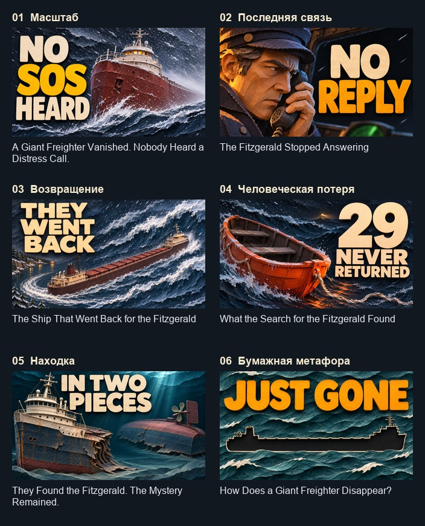

# Paper Detour — эталон смелой подачи

Пользователь принял направление шести показанных проб и поручил закрепить его для следующих изображений: «Вот это уже интереснее. Давай закрепим такой подход в документации и навыках, чтобы дальше картинки были такими же смелыми и цепляющими, а не уходили в скучный минимализм».

| Файл | Переносимый приём |
|---|---|
| [01](01.png) | Подавляющий масштаб через низкую камеру, огромный нос и уходящую в метель перспективу. |
| [02](02.png) | Человеческое напряжение через крупное лицо, руку, радиоприёмник и направленное внимание. |
| [03](03.png) | Решение идти навстречу опасности через направление судна и контраст укрытия со штормом. |
| [04](04.png) | Человеческая потеря через крупную пустую шлюпку и доминирующее число. |
| [05](05.png) | Загадка найденного состояния через два раздельных фрагмента и тёмный промежуток. |
| [06](06.png) | Исчезновение через явно материальный вырез в бумажном море. |

Пакет — пример результата [действующего визуального стандарта](../../../../../.agent/VISUAL_STAGING.md), не отдельная процедура. Он дополняет эталоны сцен. В новый сюжет переносить силу композиции и иерархию, подбирая собственные объекты, эмоцию, палитру и текст. Обложечные надписи не обязательны в обычных сценах.

Принято визуальное направление всего эксперимента; финальная обложка, названия и A/B-победитель не выбраны. CTR не измерялся. Моряк — обобщённый персонаж; волна и берег — художественная постановка без подтверждённой геометрии; обломки показывают найденное состояние, а не момент разрушения. Вырез №06 — метафора, в уменьшении может читаться как тёмный силуэт. Эти ограничения не превращать в новые утверждения истории.

Шесть PNG скопированы без изменения пикселей из выпуска 045; все 1672×941 RGB. Происхождение, исходные пути и проверенные SHA-256 — [manifest.json](manifest.json). Точные запросы — [PROMPTS.json](PROMPTS.json), входные эталоны — [REFERENCES.json](REFERENCES.json). Консультация и review сохранены как записи эксперимента до пользовательского решения, а не инструкции для нового производства.

Это общая зависимость Paper; очистка выпуска 045 не удаляет пакет. Наличие файла и SHA-256 проверять в каждом новом клоне; запись пути не подтверждает доставку. Изображения созданы генератором и не являются архивными фотографиями или историческими свидетельствами.
