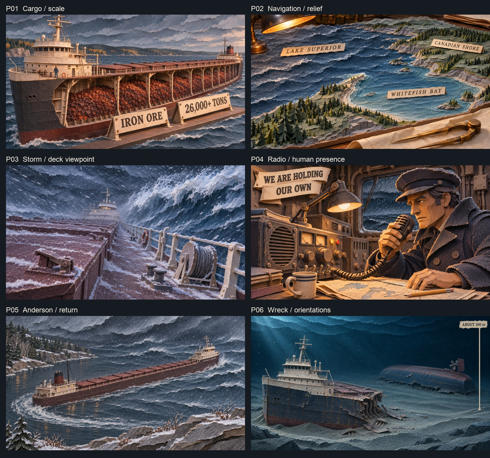

# Paper Detour — принятый пример смысловой постановки

Пользователь 5 ноября 2026 года положительно оценил показанные шесть проб Fitzgerald: «очень хорошо» — и поручил закрепить такой смысловой подход для следующих изображений Paper. Точная цитата, хеши и происхождение — в [manifest.json](manifest.json); исходные запросы imagegen — в [prompts.json](prompts.json).

| Файл | Чему служит постановка |
|---|---|
| [P01](P01_cargo_cutaway.png) | Масса груза становится видимой через разрез, повтор конструкций, фактуру руды и человеческий масштаб. |
| [P02](P02_navigation_relief.png) | Рельеф, волны и подписи объясняют пространственное отношение открытой воды и укрытия. |
| [P03](P03_storm_deck.png) | Низкая камера, перспектива палубы и волна передают угрозу изнутри действия. |
| [P04](P04_last_radio.png) | Лицо, рука и микрофон образуют центр человеческой сцены; свет и рабочие предметы поддерживают её. |
| [P05](P05_anderson_returns.png) | Курс, изогнутый след и контраст вод делают решение вернуться понятным в одном кадре. |
| [P06](P06_wreck_depth.png) | Различимая ориентация двух частей показывает итог, не выдумывая мгновение гибели. |

Применять действующую [визуальную режиссуру и раскадровку](../../../../../docs/standards/visual.md) и [профиль изображений](../../../../../docs/standards/visual.md). Пакет показывает результат этих процедур, не создаёт параллельный workflow. Число сцен, корабли, сине-янтарная палитра, подписи и разрезы не обязательны для каждого нового сюжета.

Статус приёмки — визуальное направление. P02 — условный рельеф, P04 — обобщённый моряк, P06 — поясняющая модель обломков. Детальная геометрия берега, частей судна и расстояний не подтверждена как точная реконструкция. Приёмка этих примеров не принимает готовый фильм, субтитры, движение и ещё не созданные сцены.

Шесть файлов скопированы без изменения пикселей из visual_pilot_v01 выпуска 045. Это самостоятельная общая зависимость канала; очистка завершённого эпизода не удаляет пакет. Реальная доступность для новой сессии/клона определяется наличием файлов и совпадением SHA-256.
