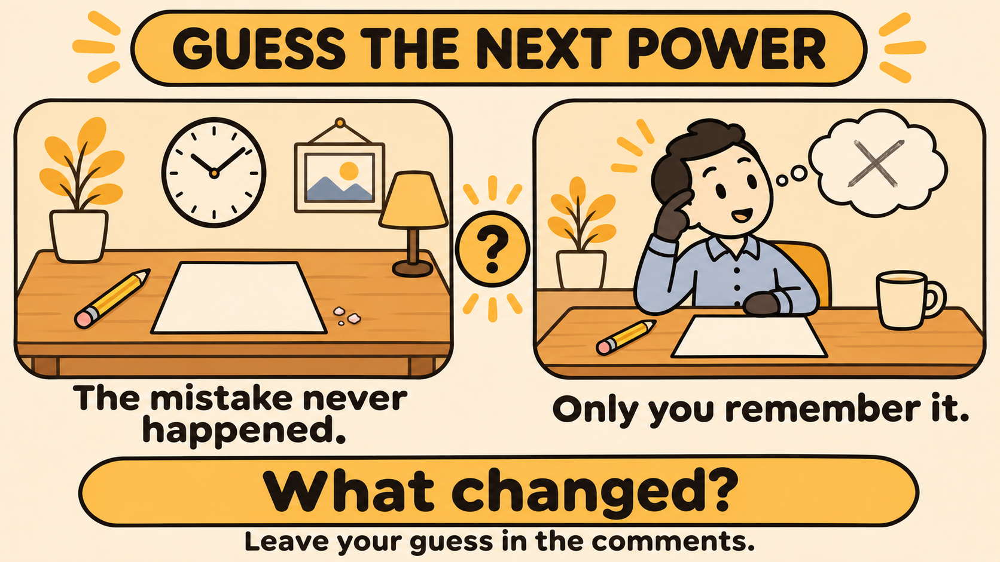

# Approved next-power teaser: Three Wishes → Rewind

Status: owner-approved reference, 2026-11-18. This is a reusable **layout and narrative pattern**, not an instruction to reuse the same drawing for every story.

## What was approved

1. Rounded printed header: **GUESS THE NEXT POWER**.
2. Two coherent illustrated clues with short captions underneath.
3. One concise inference question in a rounded bottom ribbon.
4. Small comment invitation beneath it.

Exact Rewind copy:
- The mistake never happened.
- Only you remember it.
- What changed?
- Leave your guess in the comments.

The clean paper represents an undone mistake; the remembered X represents retained memory. Together they point toward rewinding time without saying the title, number of seconds or rescue twist. This avoids an unrelated recap of the completed Three Wishes story. The owner explicitly approved the header → captioned pictures → question → comments hierarchy.

## Placement and continuity

Keep the approved ending of the completed story. Do not rewrite its final lines to manufacture this transition. Preserve the established sequence: completed story, pause/fade, discussion of that story, 10-second universal previous-video endcard, then 10-second next-power teaser. The teaser is a clearly separate post-credit invitation, not a continuation of the old plot.

In the audited Three Wishes continuity version (252.033333 seconds), this teaser occupies 242.033333–252.033333. The narration starts at 242.283 seconds. These are evidence for this version, not fixed timestamps for future videos. The next episode still starts with its normal physical-card intro and hook, not with a repeated riddle.

## Reuse rules

- Use this exact image as a style/layout reference in ImageGen. Keep rounded printed typography, cream/amber palette, clean black outlines and legible hierarchy.
- For each NEXT story choose two situation-specific clues, matching captions and an inference question. Do not copy Rewind's paper/memory or question blindly.
- Build text directly into the ImageGen image. Avoid manually positioned substitute typography except an explicitly justified special case.
- Leave enough time to read. Preserve narration, gentle motion and smooth music entrances/exits; do not alter the owner's approved final dialogue.
- Check the teaser against the next story and the publishing order. Distinguish the previous-video endcard from the next-story guessing scene.
- Save the exact approved image, prompt, source hashes, wording and timing together. This approval is evidence for this sample, not blanket approval of future generated images.

## Provenance and verification

- Image source: production `canonical_intros/rewind.png`, byte-identical to `finale_v6/riddle.png`.
- Original ImageGen output: `exec-77c1a102-f8c4-45dc-a848-1be4c78184de.png`.
- SHA256: `597a3de7a190be895136041a23fa80cd1bad18aa6408f42f914430257cd15855`.
- Git blob: `e7c80067626fd25e71c3964263a305aa6e8399b9`.
- Exact generation prompt: [imagegen-prompt.txt](imagegen-prompt.txt).
- Canonical clip evidence: [clip-evidence.json](clip-evidence.json).
- Original PNG inspected full size; all five text blocks and clue relationship verified. No new audio listening PASS is claimed by this documentation update.
