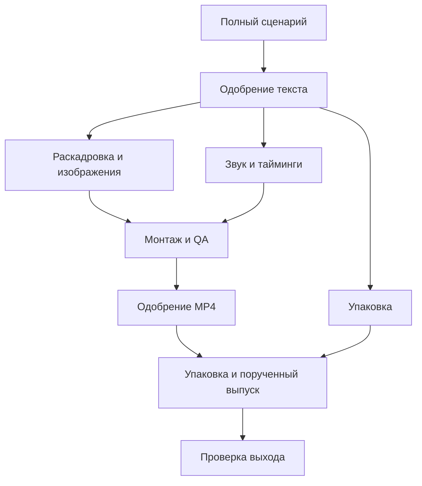

# Общий процесс выпуска

Этот документ владеет порядком действий и полномочиями. Канальные профили меняют параметры и рецепт производства, сохраняя те же состояния и две контрольные точки.

## Вход и результат

| Запрос | Действие | Первый результат пользователю |
|---|---|---|
| «Нужен сюжет для канала …» | Создать run, исследовать, выбрать тему и написать полный текст | Полный сценарий с конкретной ценностью для зрителя; запрос одобрения текста |
| «Дай идеи / варианты тем» | Ограничить область исследованием | Кандидаты и рекомендация; производство не начинается |
| «Вот сценарий, сделай видео» | Зарегистрировать точный текст и событие разрешения | Проверенный MP4, если текст уже принят в поручении |
| «Продолжай выпуск …» | Найти run, прочитать состояние и проверить незавершённые операции | Следующий готовый результат, без повторного уже выполненного |
| «Исправь сцену / субтитры» | Изменить нужные входы, инвалидировать только зависимые результаты | Новая версия MP4 на согласование |
| Узкая проверка или правка | Выполнить только заданное действие | Проверка или изменённый артефакт в указанной области |

Если intent неоднозначен, сначала выполнить доступную безопасную работу, затем задать один конкретный вопрос. Для нового выпуска bundle не нужен. Для существующего выпуска неизвестные IDs, approvals и медиа не восстанавливать выдумкой.

## Исполнение

1. **Создать или восстановить run.** Зафиксировать канал, формат, язык, intent, профиль, версии workflow/skills/code и бюджет. Проверить доступные capabilities. Ранний blocker должен указывать затронутый этап, а не запрещать всё производство.
2. **Исследовать и написать.** Проверить темы текущих/выпущенных работ, самостоятельно выбрать содержательный угол, проверить фактическую основу и написать полный текст. В research notes сохранить возможное визуальное обещание и место, где сценарий его выполняет, по [thumbnails](standards/thumbnails.md); это рабочая гипотеза, не обещание CTR и не инструкция внутри narration. Ограниченный review выполняется до выдачи; пользователь выбирает тему отдельно только по прямому запросу.
3. **Получить одобрение текста.** Согласие пользователя в чате связать с показанной ревизией/хешем и сохранить вместе с точным сообщением и его IDs через `approve --event` по [контракту](operations/task-contract.md#approval-и-продолжение). После этого продолжить производство без запроса ключей, паролей или повторного согласия. Одобрение не появляется из `complete` или из самоотчёта модели.
4. **Произвести.** После одобрения параллельно готовить раскадровку/сценовые задания, звук и раннюю упаковку, насколько позволяют зависимости. Концепции и QA обложек — по [thumbnails](standards/thumbnails.md), последовательность packaging → thumbnail tasks → готовые release assets — по [release](standards/release.md). Картинки принимаются по мере готовности; свободный worker получает следующую сцену. Финальные тайминги, слова, SRT и монтаж зависят от принятого финального звука. Не менять смысл принятого текста ради удобства генератора.
5. **Проверить и показать MP4.** Технический QA и просмотр/прослушивание различаются. Исправить подтверждённые дефекты в пределах бюджета. Готовый MP4 показывать сразу; незавершённая упаковка не удерживает его. Желательно приложить готовые название/обложку/описание, но отдельное одобрение пакета не требуется.
6. **Получить одобрение MP4.** Сохранить точный SHA-256, версию и сообщение пользователя из чата со scope `accept_mp4`. Любое изменение bytes после одобрения означает другой артефакт. Для содержательной переработки текста вернуться к соответствующему согласованию.
7. **Оформить и выполнить порученный выпуск.** Завершить применимую упаковку; upload и публикацию выполнять только по прямому поручению пользователя и в указанной им области доступа. Загрузить явно Private, проверить обработку/субтитры/thumbnail/настройки. При порученном расписании выбрать допустимый слот и сохранить его. Подготовка и одобрение MP4 сами по себе не разрешают внешние действия.
8. **Подтвердить и завершить.** Прочитать сохранённое состояние YouTube, сохранить receipt, архивировать и очистить разрешённые локальные media по storage policy. Проверку фактического Public и применимый A/B вести отдельными последующими задачами; расписание не равно уже состоявшейся публикации. План теста, подтверждённый запуск и наблюдённый результат фиксировать раздельно; pending follow-up не означает работающее фоновое наблюдение.

## Граф зависимостей

Упаковка может уточняться по финальному монтажу; главы всегда связаны с его точными таймингами. Один renderer или один недоступный провайдер не блокирует независимые готовые задачи других выпусков.

## Изменения, повторы и завершение

`next` вычисляет готовую работу из сохранённых входов и зависимостей. `context` передаёт skill, выбранные документы с содержимым и hashes, профиль/рецепт канала, входы, outputs/checks, бюджет и разрешённые tools. Для новых runs тексты и маршруты закреплены одним snapshot; исполнителю выдаётся только нужная часть. Тот же manifest доступен image worker внутри sandbox. Поля, фильтры и legacy-граница — [контракт контекста](operations/task-contract.md#требования-в-контексте). Worker не получает право менять статус чужого этапа.

При изменении входа устаревают только его зависимые артефакты. Сохранённый проверенный результат не генерировать заново ради нового чата. Результат старого worker с устаревшей версией не может заменить новый. Отмена запрещает новые задачи и внешние действия; уже отправленная операция может завершиться и требует сверки.

Для внешнего действия резервировать уникальный operation key до отправки. `UNKNOWN` после timeout означает сверить существующую операцию, а не повторить её. Журнал содержит запрошенные и фактические значения, исполнителя, версии, время и evidence. Успех CLI не превращает stage в художественно принятый.

## Бюджет и блокеры

На run задаются пределы времени активной работы, стоимости и попыток; ожидание пользовательского решения учитывается отдельно. Платные параллельные задачи резервируют бюджет атомарно. Неизвестную стоимость не записывать как ноль. При исчерпании бюджета сохранить лучший проверенный результат и точную причину остановки.

Blocker содержит `stage`, причину, evidence, выполненное автоматическое восстановление, следующую проверку и действие пользователя, если оно действительно нужно. Примеры: отсутствует голос/шрифт; не подтверждены права; нет OAuth; недоступен обязательный Studio путь; неясно, какой файл одобрен. Безопасный выбор метода, исправление схемы, отдельной сцены или временного сбоя — задача агента.
