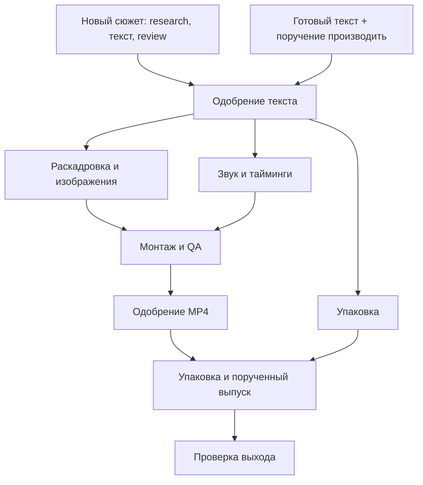

# Общий процесс выпуска

Этот документ владеет lifecycle, областью поручения и согласованиями. Пошаговое исполнение принадлежит [skills и общей процедуре](../.agents/skills/ytv-start/references/task-execution.md). Канальные профили меняют параметры и рецепт производства, сохраняя те же состояния и две контрольные точки.

Повествовательный рецепт принимает полный текст озвучки. Клиповые и музыкальные рецепты используют применимый [типизированный монтажный план](operations/task-contract.md#outputs) с реальной речью источника, narration либо без речи по профилю. Дальше «сценарий» обозначает этот принятый содержательный вход; проверять его нужно в соответствующем формате.

## Вход и результат

| Запрос | Действие | Результат работы |
|---|---|---|
| «Нужен сюжет для канала …» | Вызвать `start`, исследовать одну историю, подготовить [версии длительности](standards/editorial.md#версии-на-2-5-и-10-минут) и сравнить их | Полный пакет и рекомендация; один явно названный exact script на `awaiting_script_approval` |
| «Дай идеи / варианты тем» | Ограничить область исследованием | Кандидаты и рекомендация; производство не начинается |
| «Вот готовый сценарий, сделай видео» / «Бери в работу PR» с полным текстом | Зафиксировать выбранные bytes/commit, зарегистрировать исходное поручение по маршруту принятого текста ниже | Раскадровка, звук и упаковка; затем проверенный MP4, без второго исследования и редакторского допуска |
| «Продолжай выпуск …» | Найти run, прочитать состояние и незавершённые операции | Следующий готовый результат, без повторного уже выполненного |
| «Исправь сцену / субтитры» | Изменить нужные входы, инвалидировать только зависимые результаты | Новая версия MP4 на согласование |
| Узкая проверка или правка | Выполнить только заданное действие | Проверка или изменённый артефакт в указанной области |

Новый сюжет и запрос только на полный сценарий используют `start`: сначала сохранить run и прочитать выдаваемый пакет, затем исследовать/писать. Для готового production script `start --source-script` сохраняет вход, но сам не создаёт approval: до исполнения research применить отдельный маршрут ниже. Копируемая команда старта — [task contract](operations/task-contract.md#новый-сценарный-run). Если intent неоднозначен, выполнить безопасную работу и задать один конкретный вопрос. Для нового выпуска bundle не нужен; неизвестные IDs, approvals и медиа не восстанавливать выдумкой.

## Готовый текст и набросок

| Вход | Что делать со сценарием |
|---|---|
| Просьба найти историю | Сравнить темы и написать историю по [стандарту отбора](standards/editorial.md#отбор-до-полного-сценария) |
| Заданная тема, синопсис, запрос на доработку | Исследовать этот замысел, подготовить и сравнить пакет длительностей; показать версии и предлагаемый exact script на script gate |
| Полный текст / однозначно выбранный полный сценарий в PR плюс поручение производить | Импортировать неизменённый текст и исходное разрешение; перейти к production tasks без повторного editorial review |
| Ссылка на PR без команды производить | Прочитать материал в запрошенном scope; ссылка и Git-статус сами не разрешают производство |

«Бери в работу» с однозначным готовым сюжетным PR означает принятие **выбранной версии текста для производства**, а не заказ нового сценария. Сохранить repo/PR, commit, путь языка озвучки и SHA-256. Если PR содержит несколько конкурирующих финальных версий без однозначного выбора пользователя, только набросок либо выбранный текст изменился после поручения — уточнить именно этот вход; не подставлять другой текст или новый HEAD молча. Служебное `EDITORIAL_CANDIDATE_UNREGISTERED` в PR не отменяет последующее подлинное решение владельца; оно только честно описывает прежний статус.

Неполный набросок, предложенный агентом перевод и содержательно изменённый текст не являются тем же exact production script. Для них сохраняется обычная разработка, independent review и показ итоговой версии. Не угадывать согласие по цитатам или молчанию и не считать `complete` одобрением. [Матрица готовности](operations/readiness.md) перечисляет остальные зависимости исполнения.

### Принятый источник без повторной редакции

Это тот же script approval, а не третий бизнес-gate. Локальный координатор использует `python -m ytvideos.source_script` для сохранённого через `start --source-script` полного текста. Реализация проверяет revision/hash, целостность bytes, допустимый формат сценария и подлинную запись поручения в рамках существующей local-session trust boundary. Она не оценивает сюжет и не утверждает, что историческое исследование или независимое чтение повторно выполнены.

```bash
uv run python -m ytvideos.source_script \
  --run RUN_ID --revision SHOWN_REVISION --sha256 SELECTED_SCRIPT_SHA256 \
  --source ACTUAL_OWNER_MESSAGE_REF --message 'точное поручение владельца' \
  --origin IMMUTABLE_PR_COMMIT_AND_SCRIPT_PATH
uv run ytv next --run RUN_ID
```

Подставлять реальные значения, не копировать placeholders как evidence. Параметры `--db`, `--workspace`, `--project-root` и переменные `YTV_DATABASE_URL`/`YTV_WORKSPACE` выбирают тот же workspace/store, что у `ytv`; новый store для обхода старого run создавать нельзя.

Импорт атомарно регистрирует неизменённый `script` artifact и обычное `user.approved`, отмечает незаказанный `research` как `skipped` и сохраняет `script.source_imported` с источником и предыдущим состоянием. Он не создаёт `ytv-script-review-v1`, авторский PASS или притворное завершение research. Уже выполненное исследование сохраняется. Следующие задачи — `storyboard`, `audio`, `packaging`, с прежними проверками capabilities и production policy. Повтор исходного события идемпотентен; этот же источник нельзя переназначить другому run, тексту или revision.

Импорт не заменяет готовый script, существующие approvals, активные leases, UNKNOWN, blocked tasks или начавшееся производство. Для уже проверенного и зарегистрированного exact script достаточно обычного `approve` по исходному сообщению. Для blocked run сначала разобраться в причине и выполнить документированный recovery; старые pins требуют [migration](migration.md), а не нового run. Signed-only host не получает обхода через local-session helper: нужен его доверенный ingress, отсутствие которого сообщается как технический blocker без повторного согласования содержания.

### Где заканчивается редактура

Исследование темы, фактология, natural voice, независимый reviewer и исправление его замечаний относятся к **подготовке нового или явно перерабатываемого сценария**. `revise` там запускает допустимую редактуру и повторную проверку в пределах бюджета; небольшие повторы или стилистика не должны сами превращаться в просьбу к владельцу решить, как исправить текст.

При производстве принятого источника не запускать этот цикл заново, не менять hook/финал, не сокращать narration и не оценивать его «интересность» перед раскадровкой. Визуальное исследование эпохи, объектов, карт и прав допускается по production tasks и не становится новым выбором темы. Переразбиение на сцены, паузы и captions не должно менять слова master-текста.

Конкретная существенная фактическая ошибка или противоречие источников, меняющее смысл, реальный риск, отсутствующий необходимый вход или невозможность исполнения всё ещё блокируют затронутый этап. Несущественная погрешность, недоказанная идеальность и вкусовое замечание не блокируют его. Сохранить точную спорную фразу, источник и минимальное предлагаемое исправление; не скрывать факт и не переписывать историю самостоятельно. Оценка стиля или старое необязательное замечание reviewer не является таким blocker. При изменении смыслового текста нужна явная фиксация новой версии, а не перенос старого approval.

### Выбор длительности

Пакет вариантов и сравнение принадлежат [editorial](standards/editorial.md#версии-на-2-5-и-10-минут), сохранение — [task contract](operations/task-contract.md#outputs). Рекомендация автора не approval и не третий gate: выбор конкретного текста и его принятие — одно решение владельца на script gate. Один run принимает один script, не все варианты сразу. До решения никакие альтернативы не запускают media tasks.

Для текущего run предлагать master только в его закреплённом формате. Если лучший вариант требует другого формата, показать рекомендацию и конкретное ограничение; не переписывать `run.format`, ChannelSpec или pins. После выбора владельца использовать документированный маршрут ревизии/миграции; когда совместимый перенос формата не описан, остановить этот переход с blocker. Полные редакционные варианты сохраняются независимо от production readiness.

## Первый ответ

Первый ответ содержит короткий план по закреплённому run; порядок чтения и показа описан в [процедуре исполнения](../.agents/skills/ytv-start/references/task-execution.md#выполнение-и-передача). Для принятого PR назвать зафиксированный текст и ближайшие production tasks, не обещать «исследовать и подготовить сценарий» заново. План не вызывает providers и не является дополнительной контрольной точкой. Он не заменяет `doctor`, task context или принятие точного сценария/MP4.

## Исполнение

Выполнять [общую процедуру task](../.agents/skills/ytv-start/references/task-execution.md) и назначенный stage skill. Новый сюжет проходит research, пакет длительностей и сравнение; предлагаемый exact master проходит independent review и применимое loop evidence до `awaiting_script_approval`. Принятый источник использует импорт выше и исходное поручение без повторной редакционной приёмки. После принятия текста производство и упаковка следуют зависимостям ниже; готовый MP4 не ждёт упаковку. Upload/publication требуют прямого поручения и принятия точного файла. Public/A/B follow-ups сохраняются отдельно от факта scheduling.

### Отдельное одобрение внешнего видео

Генерация анимированных видеоклипов используется только для Shorts. Для остальных форматов применять изображения и монтаж по соответствующему рецепту.

Сценарный gate и поручение довести выпуск до MP4 сами по себе не разрешают генерацию видеоклипов внешним AI-провайдером. До загрузки кадров/промптов или отправки запроса показать точную партию: провайдера/модель, сцены и prompts, длительность/разрешение, число вариантов и ожидаемые кредиты; дождаться отдельного явного одобрения владельца. Сохранить источник этого решения и receipt провайдера. Одобрение действует только на показанную партию; при изменении её настроек или состава запросить новое. Локальный FFmpeg-рендер принятых материалов подчиняется обычному production scope.

## Граф зависимостей



Упаковка может уточняться по финальному монтажу; главы всегда связаны с его точными таймингами. Один renderer или один недоступный провайдер не блокирует независимые готовые задачи других выпусков.

## Изменения, повторы и завершение

`next` вычисляет готовую работу из сохранённых входов и зависимостей и выдаёт `next_action`. `context` доступен до claim и при недиспетчеризуемой задаче; тот же pinned packet получает успешный claim и image worker. Схема — [контракт контекста](operations/task-contract.md#требования-в-контексте), чтение и применение — [skill procedure](../.agents/skills/ytv-start/references/task-execution.md#до-действия). Worker не получает право менять статус чужого этапа.

При изменении входа устаревают только его зависимые артефакты. Сохранённый проверенный результат не генерировать заново ради нового чата. Результат старого worker с устаревшей версией не может заменить новый. Отмена запрещает новые задачи и внешние действия; уже отправленная операция может завершиться и требует сверки.

Для внешнего действия резервировать уникальный operation key до отправки. `UNKNOWN` после timeout означает сверить существующую операцию, а не повторить её. Журнал содержит запрошенные и фактические значения, исполнителя, версии, время и evidence. Успех CLI не превращает stage в художественно принятый.

## Бюджет и блокеры

На run задаются пределы времени активной работы, стоимости и попыток; ожидание пользовательского решения учитывается отдельно. Платные параллельные задачи резервируют бюджет атомарно. Неизвестную стоимость не записывать как ноль. При исчерпании бюджета сохранить лучший проверенный результат и точную причину остановки.

Отсутствующее или противоречивое обязательное правило — blocker так же, как недоступный вход, голос/шрифт, права или provider. Оно запрещает выполнение зависимого этапа, а не даёт агенту право выбрать собственный способ. [Процедура блокировки и продолжения](../.agents/skills/ytv-start/references/task-execution.md#блокер-и-продолжение) определяет отчёт и recovery; [task contract](operations/task-contract.md#блокировка-и-разблокировка) — переходы runtime. Независимые готовые задачи с полными инструкциями остаются разрешены.

## Сюжетный MR с готовыми production-решениями

По поручению подготовить максимально готовую заготовку результат включает [текстовый preproduction-пакет](operations/preproduction-contract.md): подробные prompts, композиции и опоры, continuity, движение, звук, монтаж и упаковку для exact master. Подготовка текста и ТЗ до передачи в производство не разрешает генерацию изображений, TTS, Flow или render. Она не добавляет workflow state, таблицу, независимый approval либо обязательный bundle всем новым работам.

Обычный `start --source-script ...` сохраняет master; прежний импорт принятого source с необязательным `--preproduction ...` атомарно фиксирует подготовленный пакет и исходное решение владельца. Storyboard task остаётся для разрешения реальных references и обязательных проверок, не для нового авторского выбора. После появления звука/картинок локально уточняются только зависящие от них параметры. Неполный пакет обозначается неполным; наличие длинного `storyboard.md` не означает завершённой подготовки. Исправление правил не превращает старую очередь в готовые пакеты и не меняет pinned runs автоматически.
