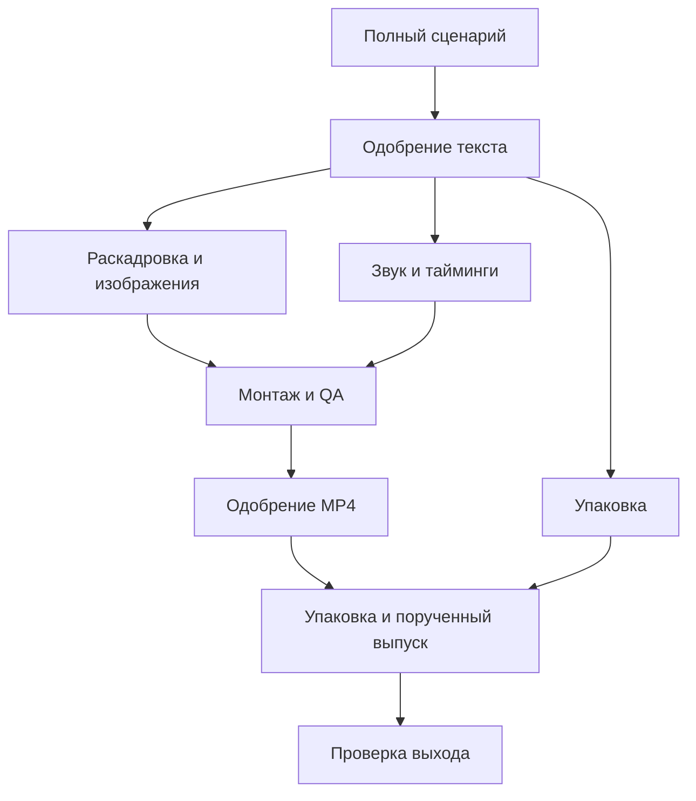

# Общий процесс выпуска

Этот документ владеет lifecycle, областью поручения и согласованиями. Пошаговое исполнение принадлежит [skills и общей процедуре](../.agents/skills/ytv-start/references/task-execution.md). Канальные профили меняют параметры и рецепт производства, сохраняя те же состояния и две контрольные точки.

Повествовательный рецепт принимает полный текст озвучки. Клиповые и музыкальные рецепты используют применимый [типизированный монтажный план](operations/task-contract.md#outputs) с реальной речью источника, narration либо без речи по профилю. Дальше «сценарий» обозначает этот принятый содержательный вход; проверять его нужно в соответствующем формате.

## Вход и результат

| Запрос | Действие | Результат работы |
|---|---|---|
| «Нужен сюжет для канала …» | Вызвать `start`, исследовать, выбрать тему и написать полный текст | Проверенный сценарий с конкретной ценностью для зрителя; run в `awaiting_script_approval` и запрос одобрения текста |
| «Дай идеи / варианты тем» | Ограничить область исследованием | Кандидаты и рекомендация; производство не начинается |
| «Вот готовый сценарий, сделай видео» | Сохранить точный production script, проверить его и зарегистрировать исходное событие разрешения через host | Проверенный MP4 при доступных production dependencies; технический blocker регистрации не требует повторного одобрения текста |
| «Продолжай выпуск …» | Найти run, прочитать состояние и проверить незавершённые операции | Следующий готовый результат, без повторного уже выполненного |
| «Исправь сцену / субтитры» | Изменить нужные входы, инвалидировать только зависимые результаты | Новая версия MP4 на согласование |
| Узкая проверка или правка | Выполнить только заданное действие | Проверка или изменённый артефакт в указанной области |

Новый сюжет и запрос только на полный сценарий используют тот же `start`, что и новый ролик: сначала сохранить run и прочитать выдаваемый пакет, затем исследовать/писать. Копируемая команда — [task contract](operations/task-contract.md#новый-сценарный-run). Если intent неоднозначен, сначала выполнить доступную безопасную работу, затем задать один конкретный вопрос. Для нового выпуска bundle не нужен. Для существующего выпуска неизвестные IDs, approvals и медиа не восстанавливать выдумкой.

## Готовый текст и набросок

| Вход | Что делать со сценарием |
|---|---|
| Просьба найти историю | Сравнить разные темы и написать выбранную историю по [единому стандарту отбора](standards/editorial.md#отбор-до-полного-сценария) |
| Заданная тема, синопсис или черновик | Исследовать именно этот замысел и подготовить полный production script; показать полный текст на script gate |
| Полный текст на языке озвучки, явно переданный для производства | Сохранить exact текст и его источник; проверить факты и редакционное качество без нового выбора темы и самовольной переработки |

Готовый присланный сценарий уже имеет пользовательское разрешение в указанной области. Runtime должен получить привязку исходного подлинного события к зарегистрированному script artifact/hash через trusted host. Отдельное повторное «одобряю» не требуется. Качество текста и регистрация разрешения — разные проверки; обнаруженный содержательный дефект нельзя исправлять незаметно.

Неполный набросок, предложенный агентом перевод и иной изменённый текст не являются тем же exact production script. После содержательной переработки показывать точную итоговую версию. После реального явного решения локальный координатор регистрирует его через `approve` по [контракту](operations/task-contract.md#approval-и-продолжение) и продолжает тот же run. Ключи и hooks для этого не нужны. Не угадывать согласие по цитатам или молчанию и не считать `complete` одобрением. [Матрица готовности](operations/readiness.md) перечисляет остальные зависимости исполнения.

## Первый ответ

Первый ответ содержит короткий план по закреплённому run; порядок чтения и показа описан в [процедуре исполнения](../.agents/skills/ytv-start/references/task-execution.md#выполнение-и-передача). План не вызывает providers и не является дополнительной контрольной точкой. Он не заменяет `doctor`, task context или принятие точного сценария/MP4.

## Исполнение

Выполнять [общую процедуру task](../.agents/skills/ytv-start/references/task-execution.md) и назначенный stage skill. Для нового сценария результат — `awaiting_script_approval` после research, полного текста, независимого review и применимого loop evidence. Exact production script использует исходное поручение. После принятия текста производство и упаковка следуют зависимостям ниже; готовый MP4 не ждёт упаковку. Upload/publication требуют прямого поручения и принятия точного файла. Public/A/B follow-ups сохраняются отдельно от факта scheduling.

### Отдельное одобрение внешнего видео

Генерация анимированных видеоклипов используется только для Shorts. Для остальных форматов применять изображения и монтаж по соответствующему рецепту.

Сценарный gate и поручение довести выпуск до MP4 сами по себе не разрешают генерацию видеоклипов внешним AI-провайдером. До загрузки кадров/промптов или отправки запроса показать точную партию: провайдера/модель, сцены и prompts, длительность/разрешение, число вариантов и ожидаемые кредиты; дождаться отдельного явного одобрения владельца. Сохранить источник этого решения и receipt провайдера. Одобрение действует только на показанную партию; при изменении её настроек или состава запросить новое. Локальный FFmpeg-рендер принятых материалов подчиняется обычному production scope.

## Граф зависимостей

Упаковка может уточняться по финальному монтажу; главы всегда связаны с его точными таймингами. Один renderer или один недоступный провайдер не блокирует независимые готовые задачи других выпусков.

## Изменения, повторы и завершение

`next` вычисляет готовую работу из сохранённых входов и зависимостей и выдаёт `next_action`. `context` доступен до claim и при недиспетчеризуемой задаче; тот же pinned packet получает успешный claim и image worker. Схема — [контракт контекста](operations/task-contract.md#требования-в-контексте), чтение и применение — [skill procedure](../.agents/skills/ytv-start/references/task-execution.md#до-действия). Worker не получает право менять статус чужого этапа.

При изменении входа устаревают только его зависимые артефакты. Сохранённый проверенный результат не генерировать заново ради нового чата. Результат старого worker с устаревшей версией не может заменить новый. Отмена запрещает новые задачи и внешние действия; уже отправленная операция может завершиться и требует сверки.

Для внешнего действия резервировать уникальный operation key до отправки. `UNKNOWN` после timeout означает сверить существующую операцию, а не повторить её. Журнал содержит запрошенные и фактические значения, исполнителя, версии, время и evidence. Успех CLI не превращает stage в художественно принятый.

## Бюджет и блокеры

На run задаются пределы времени активной работы, стоимости и попыток; ожидание пользовательского решения учитывается отдельно. Платные параллельные задачи резервируют бюджет атомарно. Неизвестную стоимость не записывать как ноль. При исчерпании бюджета сохранить лучший проверенный результат и точную причину остановки.

Отсутствующее или противоречивое обязательное правило — blocker так же, как недоступный вход, голос/шрифт, права или provider. Оно запрещает выполнение зависимого этапа, а не даёт агенту право выбрать собственный способ. [Процедура блокировки и продолжения](../.agents/skills/ytv-start/references/task-execution.md#блокер-и-продолжение) определяет отчёт и recovery; [task contract](operations/task-contract.md#блокировка-и-разблокировка) — переходы runtime. Независимые готовые задачи с полными инструкциями остаются разрешены.
