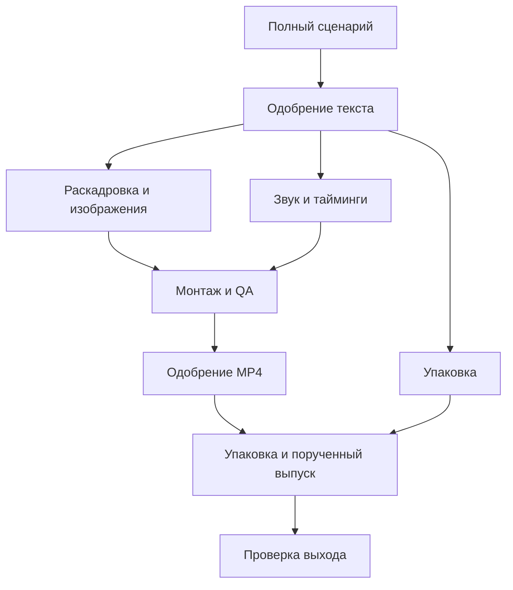

# Общий процесс выпуска

Этот документ владеет порядком действий и полномочиями. Канальные профили меняют параметры и рецепт производства, сохраняя те же состояния и две контрольные точки.

Повествовательный рецепт принимает полный текст озвучки. Клиповые и музыкальные рецепты используют применимый [типизированный монтажный план](operations/task-contract.md#outputs) с реальной речью источника, narration либо без речи по профилю. Дальше «сценарий» обозначает этот принятый содержательный вход; проверять его нужно в соответствующем формате.

## Вход и результат

| Запрос | Действие | Результат работы |
|---|---|---|
| «Нужен сюжет для канала …» | Вызвать `start`, исследовать, выбрать тему и написать полный текст | Проверенный сценарий с конкретной ценностью для зрителя; run в `awaiting_script_approval` и запрос одобрения текста |
| «Дай идеи / варианты тем» | Ограничить область исследованием | Кандидаты и рекомендация; производство не начинается |
| «Вот готовый сценарий, сделай видео» | Сохранить точный production script, проверить его и зарегистрировать исходное событие разрешения через host | Проверенный MP4 при доступных production dependencies; технический blocker регистрации не требует повторного одобрения текста |
| «Продолжай выпуск …» | Найти run, прочитать состояние и проверить незавершённые операции | Следующий готовый результат, без повторного уже выполненного |
| «Исправь сцену / субтитры» | Изменить нужные входы, инвалидировать только зависимые результаты | Новая версия MP4 на согласование |
| Узкая проверка или правка | Выполнить только заданное действие | Проверка или изменённый артефакт в указанной области |

Новый сюжет и запрос только на полный сценарий используют тот же `start`, что и новый ролик: сначала сохранить run и прочитать выдаваемый пакет, затем исследовать/писать. Копируемая команда — [task contract](operations/task-contract.md#новый-сценарный-run). Если intent неоднозначен, сначала выполнить доступную безопасную работу, затем задать один конкретный вопрос. Для нового выпуска bundle не нужен. Для существующего выпуска неизвестные IDs, approvals и медиа не восстанавливать выдумкой.

## Готовый текст и набросок

| Вход | Что делать со сценарием |
|---|---|
| Просьба найти историю | Сравнить разные темы и написать выбранную историю по editorial standard |
| Заданная тема, синопсис или черновик | Исследовать именно этот замысел и подготовить полный production script; показать полный текст на script gate |
| Полный текст на языке озвучки, явно переданный для производства | Сохранить exact текст и его источник; проверить факты и редакционное качество без нового выбора темы и самовольной переработки |

Готовый присланный сценарий уже имеет пользовательское разрешение в указанной области. Runtime должен получить привязку исходного подлинного события к зарегистрированному script artifact/hash через trusted host. Отдельное повторное «одобряю» не требуется. Качество текста и регистрация разрешения — разные проверки; обнаруженный содержательный дефект нельзя исправлять незаметно.

Неполный набросок, предложенный агентом перевод и иной изменённый текст не являются тем же exact production script. После содержательной переработки показывать точную итоговую версию. Если host bridge не подключён, сохранить исходник, проверки и план, указать технический blocker регистрации; не генерировать подпись, не считать `complete` одобрением и не обещать автоматический MP4 при закрытом gate. [Матрица готовности](operations/readiness.md) перечисляет остальные зависимости исполнения.

## Первый ответ

После `start` и до генерации сообщить пользователю короткий план из `plan_summary`; для продолжения — из `plan --run RUN_ID`: канал и формат, какие материалы уже приняты, что предстоит сделать до результата, важные требования изображения/звука/субтитров и настоящие блокеры. Для сценарного запроса назвать путь до проверенного полного текста и script gate. Для продолжения назвать сохранённый этап и используемые артефакты. Технический JSON целиком в чат не копировать.

План строится по закреплённому профилю, задачам и наблюдённым capabilities. Он не вызывает providers и не заменяет `doctor` или чтение текущего task context. Отсутствующую запись capability отличать от фактически недоступного инструмента. Если конкретный канальный рецепт ещё не определён, назвать этот выбор до монтажа.

Сообщение плана не является дополнительной контрольной точкой: после него продолжать разрешённую работу. Полный сценарий, явно переданный для производства, сохранять как принятый вход и планировать путь от него до MP4.

## Исполнение

1. **Выполнить `start` или восстановить run и показать план.** Зафиксировать канал, формат, язык, intent, профиль, версии workflow/skills/code и бюджет. Прочитать `read_next` и проверить доступные capabilities. Ранний blocker должен указывать затронутый этап, а не запрещать всё производство.
2. **Исследовать и подготовить сценарий.** Для повествовательного рецепта при поиске темы пройти [сравнительный отбор историй](standards/editorial.md#отбор-до-полного-сценария), проверить финалистов и написать полный текст выбранной истории; если подходящего кандидата нет, сохранить причину. При заданном замысле исследовать именно его. Для монтажного плана проверить реальные записи, права и развитие изображения/звука по рецепту; сохранить применимую речь источника или отсутствие речи. При готовом production script проверить точный вход без повторного выбора темы и самовольной переработки. Подробная раскадровка не заменяет проверку сценария. В research output сохранить визуальное обещание и место его выполнения по [thumbnails](standards/thumbnails.md); это рабочая гипотеза, не прогноз CTR и не инструкция внутри narration. Ограниченный review выполняется для всех трёх входов.
3. **Зарегистрировать принятие текста.** Новый сценарий готов к передаче, когда run достиг `awaiting_script_approval`: research/script завершены, независимый review и применимая петля подтверждены evidence. Markdown без этих проверок остаётся черновиком; продолжать доступную работу до gate либо реального blocker. Для нового или содержательно изменённого сценария показать полную версию и получить решение. Для exact production script использовать исходное подлинное поручение без повторного согласования. Host связывает решение с точной ревизией/хешем; `complete` и самоотчёт модели не создают approval.
4. **Произвести.** После одобрения параллельно готовить раскадровку/сценовые задания, звук и раннюю упаковку, насколько позволяют зависимости. Концепции и QA обложек — по [thumbnails](standards/thumbnails.md), последовательность packaging → thumbnail tasks → готовые release assets — по [release](standards/release.md). Картинки принимаются по мере готовности; свободный worker получает следующую сцену. Финальные тайминги, слова, SRT и монтаж зависят от принятого финального звука. Не менять смысл принятого текста ради удобства генератора.
5. **Проверить и показать MP4.** Технический QA и просмотр/прослушивание различаются. Исправить подтверждённые дефекты в пределах бюджета. Готовый MP4 показывать сразу; незавершённая упаковка не удерживает его. Желательно приложить готовые название/обложку/описание, но отдельное одобрение пакета не требуется.
6. **Получить одобрение MP4.** Сохранить точный SHA-256, версию и событие пользователя. Любое изменение bytes после одобрения означает другой артефакт. Для содержательной переработки текста вернуться к соответствующему согласованию.
7. **Оформить и выполнить порученный выпуск.** Завершить применимую упаковку; upload и публикацию выполнять только по прямому поручению пользователя и в указанной им области доступа. Загрузить явно Private, проверить обработку/субтитры/thumbnail/настройки. При порученном расписании выбрать допустимый слот и сохранить его. Подготовка и одобрение MP4 сами по себе не разрешают внешние действия.
8. **Подтвердить и завершить.** Прочитать сохранённое состояние YouTube, сохранить receipt, архивировать и очистить разрешённые локальные media по storage policy. Проверку фактического Public и применимый A/B вести отдельными последующими задачами; расписание не равно уже состоявшейся публикации. План теста, подтверждённый запуск и наблюдённый результат фиксировать раздельно; pending follow-up не означает работающее фоновое наблюдение.

## Граф зависимостей

Упаковка может уточняться по финальному монтажу; главы всегда связаны с его точными таймингами. Один renderer или один недоступный провайдер не блокирует независимые готовые задачи других выпусков.

## Изменения, повторы и завершение

`next` вычисляет готовую работу из сохранённых входов и зависимостей и выдаёт конкретный `next_action`. Если capability ещё не наблюдалась, сначала проверить tools/discovery текущего host, записать фактический результат и повторить `next`; это доступная работа, а не причина остановиться. `context` можно читать до claim и при недиспетчеризуемой задаче. Он передаёт `task_guide`, skill, выбранные документы с содержимым и hashes, профиль/рецепт канала, входы, outputs/checks, бюджет и разрешённые tools; тот же пакет возвращается при успешном `claim`. Тексты и маршруты закреплены одним snapshot; исполнителю выдаётся только нужная часть. Тот же manifest доступен image worker внутри sandbox. Поля и фильтры — [контракт контекста](operations/task-contract.md#требования-в-контексте). Worker не получает право менять статус чужого этапа.

При изменении входа устаревают только его зависимые артефакты. Сохранённый проверенный результат не генерировать заново ради нового чата. Результат старого worker с устаревшей версией не может заменить новый. Отмена запрещает новые задачи и внешние действия; уже отправленная операция может завершиться и требует сверки.

Для внешнего действия резервировать уникальный operation key до отправки. `UNKNOWN` после timeout означает сверить существующую операцию, а не повторить её. Журнал содержит запрошенные и фактические значения, исполнителя, версии, время и evidence. Успех CLI не превращает stage в художественно принятый.

## Бюджет и блокеры

На run задаются пределы времени активной работы, стоимости и попыток; ожидание пользовательского решения учитывается отдельно. Платные параллельные задачи резервируют бюджет атомарно. Неизвестную стоимость не записывать как ноль. При исчерпании бюджета сохранить лучший проверенный результат и точную причину остановки.

Blocker содержит `stage`, причину, evidence, выполненное автоматическое восстановление, следующую проверку и действие пользователя, если оно действительно нужно. Примеры: отсутствует голос/шрифт; не подтверждены права; нет OAuth; недоступен обязательный Studio путь; неясно, какой файл одобрен. Безопасный выбор метода, исправление схемы, отдельной сцены или временного сбоя — задача агента.
